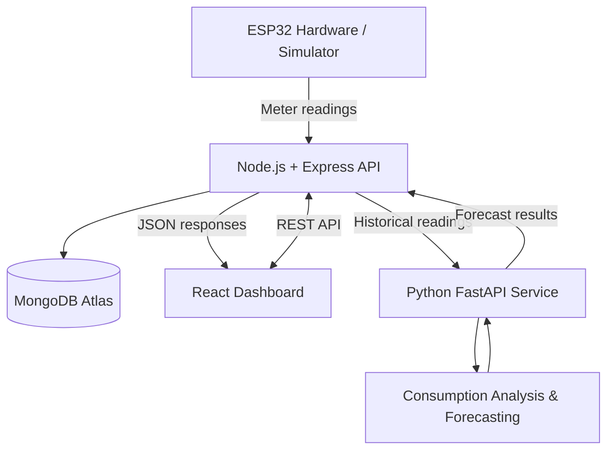

# AI-Enabled IoT Smart Energy Meter

An IoT-based energy monitoring system that combines real-time electrical readings, a web dashboard, and machine-learning-based energy consumption forecasting. The project integrates a Node.js backend, React frontend, an ESP32 simulator, and a Python forecasting service.

**Repository:** [ai-smart-energy-meter](https://github.com/Shivam-Krishna24/ai-smart-energy-meter)

## Overview

The AI-Enabled IoT Smart Energy Meter is designed to monitor electrical parameters, visualize energy consumption, and estimate future electricity usage from historical readings.

The system is organized into independent services so that data collection, application logic, visualization, and forecasting can be developed and maintained separately.

### Key Features

- **Energy monitoring:** Collect and store voltage, current, power, and cumulative energy readings.
- **Interactive dashboard:** Present energy readings and consumption information through a React web interface.
- **User authentication:** Provide registration and login functionality with protected API routes.
- **Consumption analysis:** Calculate daily and monthly energy consumption from recorded readings.
- **Machine learning forecasting:** Use historical energy readings to estimate consumption over the next seven days.
- **ESP32 simulation:** Generate simulated meter readings and transmit them to the backend for development and testing.
- **Modular architecture:** Separate the frontend, backend, simulator, and forecasting service.

## System Architecture



### Data Flow

1. The ESP32 hardware or simulator generates electrical readings.
2. The simulator sends readings to the backend through protected REST API endpoints.
3. The backend validates requests, verifies meter ownership, and stores readings in MongoDB.
4. The React dashboard requests authorized meter, consumption, and forecast data.
5. For forecasting, the backend forwards historical readings to the Python FastAPI service.
6. The forecasting service processes the readings and returns historical consumption summaries and seven-day predictions.
7. The dashboard displays the results to the user.

## Technology Stack

| Component | Technologies |
|---|---|
| Frontend | React, Vite, JavaScript, CSS |
| Backend | Node.js, Express.js |
| Database | MongoDB Atlas, Mongoose |
| Authentication | JSON Web Tokens (JWT) |
| ML service | Python, FastAPI, Pandas, NumPy, scikit-learn |
| Forecasting model | Random Forest Regression with a baseline fallback |
| Communication | REST APIs, JSON, Axios |
| Hardware simulation | Node.js-based ESP32 simulator |
| Version control | Git and GitHub |

## Project Structure

```text
energy-meter/
├── backend/
│   ├── middleware/
│   │   └── authMiddleware.js
│   ├── models/
│   │   ├── Meter.js
│   │   ├── Reading.js
│   │   └── User.js
│   ├── routes/
│   │   ├── authRoutes.js
│   │   ├── meterRoutes.js
│   │   ├── readingRoutes.js
│   │   ├── consumptionRoutes.js
│   │   └── forecastRoutes.js
│   ├── server.js
│   └── package.json
│
├── frontend/
│   ├── src/
│   │   ├── App.jsx
│   │   ├── AuthPage.jsx
│   │   ├── Dashboard.jsx
│   │   ├── api.js
│   │   └── main.jsx
│   └── package.json
│
├── esp32-simulator/
│   ├── server.js
│   └── package.json
│
├── ml-service/
│   ├── main.py
│   └── requirements.txt
│
└── .gitignore
```

## Machine Learning and Forecasting

The forecasting service is implemented using Python and FastAPI. It receives historical meter readings from the Node.js backend and processes cumulative energy values to estimate consumption.

### Forecasting Pipeline

1. **Input validation:** Validate incoming timestamps and energy readings.
2. **Preprocessing:** Sort readings chronologically and handle duplicate timestamps.
3. **Consumption calculation:** Calculate energy differences from cumulative meter readings.
4. **Daily aggregation:** Aggregate eligible consumption intervals into daily usage.
5. **Feature engineering:** Generate temporal features, including day of week, day of year, lagged consumption, and rolling averages.
6. **Forecast generation:** Use a Random Forest regression model when sufficient usable historical data is available.
7. **Fallback strategy:** Use a recent-observation average when the history is insufficient for the model-based approach.
8. **API response:** Return historical summaries, forecast values, and applicable evaluation metrics.

### Forecasting Considerations

- The service requires historical readings with timestamps and cumulative energy values.
- Negative differences in cumulative energy are treated as possible meter resets and rejected.
- Long gaps between readings are excluded from interval-based consumption calculations.
- The model uses historical patterns; predictions are estimates rather than guaranteed future usage.
- Model evaluation metrics are meaningful only when calculated against an appropriate held-out dataset.

## Backend API Overview

The backend exposes REST endpoints grouped by functionality.

| Endpoint | Purpose |
|---|---|
| `/api/auth` | User registration, login, and authentication |
| `/api/meters` | Meter-related operations |
| `/api/readings` | Submit and retrieve meter readings |
| `/api/consumption` | Retrieve consumption summaries |
| `/api/forecast` | Request energy consumption forecasts |

Protected endpoints use JWT-based authentication through the `Authorization: Bearer <token>` header. Exact request formats and supported HTTP methods are defined in the route implementations.

The forecasting service exposes a `POST /forecast` endpoint that accepts historical readings.

## Getting Started

### Prerequisites

Install the following software before running the project:

- Node.js and npm
- Python 3.10 or a compatible version supported by the installed dependencies
- MongoDB Atlas account or another compatible MongoDB deployment
- Git

### 1. Clone the Repository

```bash
git clone https://github.com/Shivam-Krishna24/ai-smart-energy-meter.git
cd ai-smart-energy-meter
```

### 2. Configure Environment Variables

Create the required local environment files for the backend and simulator.

Use the variable names expected by the application code. Configure your MongoDB connection string, JWT secret, backend URL, simulator settings, and authentication credentials as applicable.

The backend forecasting integration uses:

```env
ML_SERVICE_URL=http://127.0.0.1:8000
```

Keep all credentials in local environment files. Never commit real secrets to GitHub.

### 3. Start the Backend

```bash
cd backend
npm install
node server.js
```

The backend is configured to run at:

`http://localhost:5000`

### 4. Start the Frontend

Open a separate terminal:

```bash
cd frontend
npm install
npm run dev
```

Open the local URL printed by Vite, typically:

`http://localhost:5173`

### 5. Start the ML Forecasting Service

Open another terminal:

```bash
cd ml-service
python -m venv venv
```

Activate the environment on Windows PowerShell:

```powershell
.\venv\Scripts\Activate.ps1
```

Install the dependencies and start FastAPI:

```bash
python -m pip install -r requirements.txt
python -m uvicorn main:app --reload --host 127.0.0.1 --port 8000
```

Open the interactive API documentation at:

`http://127.0.0.1:8000/docs`

### 6. Start the ESP32 Simulator

Open another terminal:

```bash
cd esp32-simulator
npm install
node server.js
```

Configure the simulator's environment variables before starting it. The simulator must have valid backend settings, meter information, and authentication credentials to submit readings successfully.

**Note:** The backend, frontend, ML service, and simulator are separate processes. Start each one in its own terminal during local development. Verify the scripts and environment variable names in the corresponding source files if your local configuration differs.

## Database and Data Model

The backend uses MongoDB with Mongoose models for users, meters, and readings.

- **User:** Stores account information used for authentication.
- **Meter:** Associates a meter identifier and metadata with its owner.
- **Reading:** Stores electrical measurements and timestamps, linked to a meter.

Reading records include voltage, current, power, cumulative energy, and measurement time. The backend validates readings and checks meter ownership before processing protected requests.

## Security

- Keep `.env` files and credentials out of version control.
- Use a strong, unique JWT secret.
- Protect authenticated endpoints and validate incoming data.
- Restrict access to meters and readings according to ownership.
- Use HTTPS and secure deployment configuration outside local development.
- Never publish real database credentials, tokens, or API keys in source code or screenshots.

## Future Improvements

- Integrate physical ESP32 hardware and a suitable energy measurement sensor.
- Add configurable alerts for abnormal consumption and usage thresholds.
- Improve forecasting with larger, more representative historical datasets.
- Track model performance over time and compare forecasting algorithms.
- Add deployment instructions and automated tests for all services.
- Deploy the frontend, backend, and ML service to production environments.

## Contributing

Contributions, bug reports, and suggestions are welcome. For significant changes, open an issue first to discuss the proposed improvement.

**Developed as an AI and IoT energy-monitoring project**, combining web development, database-backed data collection, and machine-learning-based consumption forecasting.
